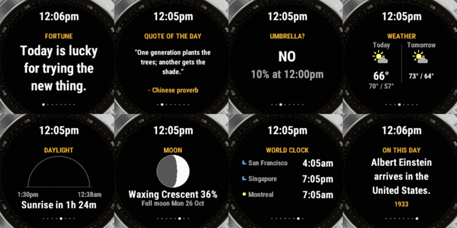

# garminy

[](https://github.com/williamthepoon/garminy/actions/workflows/ci.yml)
[](LICENSE)


garminy turns a retired Garmin fēnix 7 into a desk display. It sits on a stand on the charger and rotates through glanceable cards.



> **Status:** garminy and the Mac companion run on a real fēnix 7, and all unit tests pass. It is not on the Connect IQ Store yet, so install it by sideloading (see below).

## Cards

| Card | Shows |
|---|---|
| Agents | Your Claude Code sessions and what each is doing (needs the [Mac companion](#mac-companion-optional)) |
| Fortune | One fortune per day |
| Motivational quote | One public-domain quote per day |
| Umbrella? | **YES / MAYBE / NO** from the highest hourly rain chance in the next 12 h (YES ≥ 50%, MAYBE 30–49%, NO < 30%) |
| Weather | Today and tomorrow: icon, high/low, current temperature |
| Daylight | Sun arc, sunrise/sunset, daylight left or time until sunrise |
| Moon phase | Drawn moon, phase name, illumination, next full moon |
| World clock | Up to 3 cities (default San Francisco, Singapore, Montreal), DST-aware |
| On this day | A historical event for every date of the year |

It needs no accounts, API keys or servers. Weather comes from the watch's built-in Garmin weather, which the Garmin Connect phone app keeps up to date. A watch without a phone can get weather from the [Mac companion](#mac-companion-optional) instead. Everything else is bundled with the app or calculated on the watch.

## Controls

garminy never uses the START button, so a watch with a broken START button works fine.

| Input | Action |
|---|---|
| DOWN / swipe up | Next card |
| UP / swipe down | Previous card |
| Tap | Dismiss the alert on screen (a Claude alert also opens that session on the Mac); otherwise pin or unpin the current card (an orange dot right of the clock means pinned) |
| Hold BACK for 1 s | Exit (a short press only shows a hint) |

**Opening it:** from the watch face, press UP or DOWN to scroll through the glances, then tap the **GARMINY** glance.

## Settings

In the Garmin Connect app on your phone, go to **Devices → fēnix 7 → Activities & Apps → garminy → Settings**:

- Turn each card on or off
- Seconds per card: 5, 10, 20, 30 or 60
- World clock cities 1–3, chosen from 45 cities, or None
- Temperature units: follow device, °C or °F
- Backlight: Off, Low, Medium or High. Holds the light on while garminy is open. Use it only on a charger.
- On the charger: what an alert that would buzz does while the watch is charging, since the watch can't vibrate then. Nothing, Beep (default), Light, or Beep and light. Beeps need the watch's own **Alert Tones** setting on (MENU → System → Sound & Vibe).
- Beep sound: Soft (default: quiet low clicks), Chime, or Standard (Garmin's loud built-in tones). The companion's Watch settings window has a **Test on watch** button to hear it.
- Mac companion: On (default) or Off. Off stops all Bluetooth use by garminy.

No phone? The Mac companion's **Watch settings** window has the same options and sends them to the watch over Bluetooth. Whichever change is most recent wins.

## Mac companion (optional)

A small menu-bar app for macOS 14 or later that turns the watch into a status light for your desk. It runs only on your Mac: no account, no server, no API key. The watch connects to it over Bluetooth while garminy is open.

- **Agents card:** every Claude Code session by folder name, with its state (working, needs you, done, error) and how long it has been in it.
- **Alerts:** when an agent needs you, finishes a long turn or fails, or a long terminal command finishes, the watch shows it full screen and buzzes. Tap the watch to dismiss it; it is dismissed on the Mac too.
- **Tap to open:** tapping a Claude Code alert (needs you, done or failed) brings that session to the front on the Mac. Working in that session's tab on the Mac clears its alerts from the watch within a few seconds, without a tap. In iTerm2 and Terminal it selects the exact tab; in other apps (VS Code, Ghostty and so on) it brings the app forward. The first time, macOS asks whether garminy Companion may control iTerm2 or Terminal. Update the watch app and the companion together, because an older companion ignores this tap.
- **Buzzes only when useful:** no buzz while you're typing in that terminal, one buzz if you're in another app, and if you're away (idle 2 minutes or screen locked) a needs-you alert buzzes again every 5 minutes, up to 3 more times.
- **Keeps the Mac awake** while an agent works or a long command runs, so idle sleep doesn't stop it. Turn this off in the menu.
- **Weather and settings for a phone-less watch** (see below). Open the **Watch settings** window from the menu, or by opening garminy Companion again from Spotlight or Finder.

| Alert | Colour | Buzz |
|---|---|---|
| Needs you | orange | three pulses |
| Failed | red | two sharp pulses |
| Done | green | one short pulse |

A coloured dot left of the clock shows the most urgent session state; grey means the Mac is out of reach.

### Install

Needs Xcode or the Xcode command line tools.

```sh
scripts/mac-signing-identity.sh   # once: a local signing certificate, so macOS keeps permissions across rebuilds
scripts/bundle-mac.sh             # builds, installs ~/Applications/garminy Companion.app and ~/.local/bin/garminy-hook, and starts it
```

macOS asks for Bluetooth access the first time. Turn on **Launch at login** in the menu if you want it to start with your Mac.

### Claude Code

Install the plugin, which adds hooks next to any you already have and changes nothing else:

```sh
claude plugin marketplace add williamthepoon/garminy
claude plugin install garminy@garminy
```

Remove it with `claude plugin uninstall garminy@garminy`.

### Terminal alerts

Choose **Set up terminal alerts…** in the menu, or add this line to `~/.zshrc`:

```sh
eval "$(~/.local/bin/garminy-hook shell-init zsh)"
```

Commands that run 30 seconds or longer alert the watch when they finish. Set `GARMINY_LONG_CMD_SECS` to change the threshold and `GARMINY_IGNORE` to change the list of interactive programs to skip (editors, pagers, ssh and so on). Commands that Claude Code runs itself are never reported.

### Weather without a phone

When macOS asks, allow **garminy Companion** to use your location. The companion fetches a forecast for this Mac's location from [Open-Meteo](https://open-meteo.com/) about every 30 minutes and sends it to the watch, which uses it when it has no Garmin weather. Weather data by Open-Meteo.com, licensed [CC BY 4.0](https://creativecommons.org/licenses/by/4.0/).

### Privacy

The Bluetooth link is not encrypted, so assume nearby devices could read it. Only this crosses it: folder names (16 characters at most), session states and times, the first word of a command with its duration and exit code, the weather, a location rounded to 2 decimal places (about 1 km), and garminy's settings. Prompts, Claude's replies, tool inputs, file contents and full command lines never leave your Mac; the hook drops them before they reach the companion.

## Build

Requirements:
- A JDK, for example `brew install openjdk@21`.
- The [Connect IQ SDK](https://developer.garmin.com/connect-iq/sdk/), installed with SDK Manager, plus the **fēnix 7** device.
- A developer key:

```sh
mkdir -p ~/.garmin
openssl genrsa -out ~/.garmin/developer_key.pem 4096
openssl pkcs8 -topk8 -inform PEM -outform DER -in ~/.garmin/developer_key.pem -out ~/.garmin/developer_key.der -nocrypt
```

Then build and test:

```sh
scripts/build.sh      # builds bin/garminy-fenix7.prg
scripts/test.sh       # runs the unit tests in the simulator
```

Edit text content in `content/*.json`. The build checks it (maximum 90 characters per entry, every date covered) and generates `resources/jsonData/`.

## Install on the watch (sideload)

**One command (macOS):** plug in the watch, quit Garmin Express, then run:

```sh
brew install libmtp      # once
scripts/sideload.sh      # builds, then copies GARMINY.PRG onto the watch
```

Unplug the watch to install. Running it again replaces the app in place and keeps your settings.

**Manually:**

1. Connect the watch to your computer with its USB cable. On macOS, use [OpenMTP](https://openmtp.ganeshrvel.com/) and fully quit Garmin Express first.
2. Copy `bin/garminy-fenix7.prg` into `GARMIN/APPS/` on the watch.
3. Unplug the watch. garminy appears in the glance loop.

## Desk tips

- **Use a power-only charger** (a wall adapter), not a computer port. When the watch is connected to a computer, it switches to USB mode and stops apps.
- **Leave garminy open.** Going back to the watch face can close it. Reopen it from the glance.
- **Disable Sleep Mode or schedule it around your desk hours** (System → Sleep Mode) so the watch keeps showing cards.
- **Make it brighter:** the screen is reflective, so a desk lamp helps most. For evenings, set Backlight to Low, Medium or High.
- **Protect the battery from being held at 100% for months.** A smart plug on a schedule can keep it roughly between 40% and 80%.

## Contributing

Issues and PRs are welcome. Read [CONTRIBUTING.md](CONTRIBUTING.md) first. In short: fēnix 7 only, no API keys or servers, and never rely on the START button.

The project uses [OpenSpec](https://openspec.dev/) for spec-driven development. Specs are in `openspec/specs/`, and in-progress changes are in `openspec/changes/`. Release notes are in [CHANGELOG.md](CHANGELOG.md).

## Licence

MIT. Fortunes and on-this-day text are original. Quotes are public domain or proverbs.
